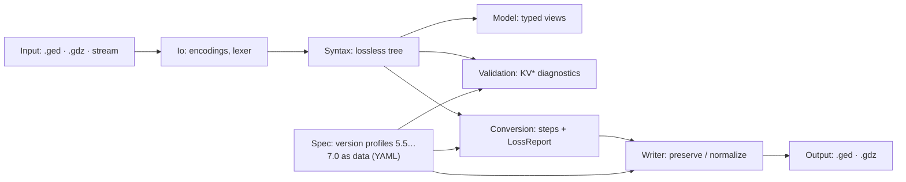

# Specification: Korin, a GEDCOM library for PHP

Nov 14, 2026 · @Serhii

## 1. Goal and scope

Korin is an open-source PHP library that reads, validates, converts and writes GEDCOM 4.0 through 7.0.x without losing data. Every loss that cannot be avoided when moving to an older version is recorded explicitly in a report.

The library is the foundation of the "Pam'iat pro sebe" archive, but it is developed as a standalone product for anyone.

**In scope for v1.0:**

- reading GEDCOM 4.0, 5.0–5.4 (best effort), 5.5, 5.5.1, 5.5.5, 7.0.x and GEDZIP;
- writing 5.5, 5.5.1, 5.5.5, 7.0.x and GEDZIP;
- automatic detection of version and encoding;
- conversion between any two versions with a loss report;
- validation against the profile of a specific version;
- preservation of unknown and `_` tags;
- typed access to records (individuals, families, sources, media, dates, names, places);
- streaming (`stream()`) and indexed (`open()`) modes for large files;
- a CLI tool in a separate package.

**Out of scope for v1.0:** GEDCOM X (a separate package later), tree visualization, FamilySearch or Ancestry APIs, database storage, merging duplicate individuals.

## 2. Name, license, hosting

The name is **Korin** (from Ukrainian «корінь», "root"): short, easy to read in English, and free of the GEDCOM trademark. The license is Apache-2.0.

| What | Value |
| --- | --- |
| Composer package | `korin/gedcom` |
| Namespace | `Korin\Gedcom` |
| GitHub | `serjio-dev` (personal account): [serjio-dev/korin-php](https://github.com/serjio-dev/korin-php) |
| Repositories | `korin-php` (library), `korin-cli` (tool), `gedcom-corpus` (shared test corpus) |
| Registry | Packagist, auto-updated from git tags |
| Documentation | GitHub Pages from the `docs/` directory |

**Why Apache-2.0.** The FamilySearch GEDCOM specification and its machine-readable files are distributed under Apache-2.0 ([FamilySearch](https://www.familysearch.org/help/helpcenter/article/what-is-the-familysearch-gedcom-7-0-standard)), so they can be included in the repository without a license conflict. Apache-2.0 provides a patent grant and is compatible with MIT and GPLv3 projects.

**Trademark.** In the README and on the site: "GEDCOM is a trademark of Intellectual Reserve, Inc. Korin is not affiliated with or endorsed by FamilySearch."

**Rejected names:** Rodovid (taken by the genealogy site rodovid.org), gedkit / gedcomkit (taken by a [Rust library](https://docs.rs/crate/gedcomkit/0.1.4)).

**Open question:** register the `korin` vendor on Packagist before the first release; if it is taken, the fallback is `serjio-dev/korin`.

## 3. GEDCOM versions, encodings and dialects

Full support covers 5.5, 5.5.1, 5.5.5 and 7.0.x; older versions are read only. As of 14.11.2026 the latest release is [7.0.18 of 17.02.2026](https://en.wikipedia.org/wiki/GEDCOM); 7.1 is still a working draft.

| Version | Read | Write | Note |
| --- | --- | --- | --- |
| 7.1 (draft) | — | — | Tracked in a separate branch, added after the official release |
| 7.0.0–7.0.18 (2021–2026) | ✓ | ✓ | UTF-8 only, `SCHMA` for extensions, GEDZIP (`.gdz`) |
| 5.5.5 (2019) | ✓ | ✓ | Clarification of 5.5.1 by the gedcom.org community |
| 5.5.1 (1999, re-issued 2019) | ✓ | ✓ | The most widespread; default format for "compatibility" exports |
| 5.5 (1996) | ✓ | ✓ | Encodings ANSEL, ASCII, UNICODE (UTF-16) only |
| 5.0–5.4 (drafts) | best effort | — | Read with the 5.5 profile in lenient mode |
| 4.0 | best effort | — | Old PAF exports; converted to 5.5 with a report |
| GEDCOM X | — | — | A different model (JSON/XML); separate `korin/gedcomx` package after 1.0 |

**Encodings for reading:** UTF-8 (with and without BOM), UTF-16 LE/BE, ASCII, ANSEL (with reordering of combining diacritics), Windows-1250/1251/1252, CP437/CP850 (IBMPC), MacRoman. Windows-1251 is non-standard but mandatory: many programs export Cyrillic that way.

**Detection order:** BOM → `HEAD.CHAR` → byte heuristics. If `CHAR` contradicts the content, the content wins and a warning is added to the diagnostics. The encoding can be set explicitly.

**Encodings for writing:** 7.0 and 5.5.5 — UTF-8; 5.5.1 — UTF-8 (or ANSEL / UTF-16 as an option); 5.5 — UTF-16 (or ANSEL). A character missing from the target encoding produces a loss report entry, never a silent replacement with `?`.

**BOM** (byte order mark, the character U+FEFF at the start of a file; in UTF-8 the bytes `EF BB BF`) carries no data; it only hints the encoding to other programs.

| Writing | BOM by default | Why |
| --- | --- | --- |
| 7.0 | Yes | 7.0 specification: "The first character in each data stream should be U+FEFF" |
| 5.5.5 | Yes | 5.5.5 specification: "All GEDCOM 5.5.5 files, UTF-8 as well as UTF-16 GEDCOM files, must start with a Byte Order Mark (BOM)." |
| 5.5.1, 5.5 in UTF-8 | No | The specifications do not mention a BOM; some old programs do not recognize `0 HEAD` after a BOM |
| UTF-16 in any version | Yes | Without a BOM the byte order has to be guessed |

`WriteOptions::withBom(bool)` changes the behavior; `preserve` mode keeps the BOM as it was in the source.

**Vendor dialects.** The library identifies the source program from `HEAD.SOUR` and applies documented fixes for its known bugs. Target list for the corpus: Ancestry, FamilySearch, MyHeritage, Family Tree Maker, RootsMagic, Legacy, PAF, Gramps, webtrees, Heredis, Family Historian, GeneWeb. Unknown and `_` tags (`_UID`, `_APID`, `_FSFTID`, `_FREL`, `_MREL`, etc.) are always preserved. Meanings of known tags come from the extension registry, not from guesses.

## 4. PHP versions and dependencies

The minimum is PHP 8.2; the v1.x range is 8.2–8.6. Supporting 8.0 and 8.1 is not worth it: they no longer receive even security fixes, 8.0 has no enums, and readonly classes only arrived in 8.2.

| PHP | Security support until | Korin 1.x |
| --- | --- | --- |
| 8.6 | GA [19.11.2026](https://php.watch/versions/8.6/releases) | ✓ (in CI from the RC) |
| 8.5 | 31.12.2029 | ✓ |
| 8.4 | 31.12.2028 | ✓ |
| 8.3 | 31.12.2027 | ✓ |
| 8.2 | 31.12.2026 | ✓ (minimum) |
| 8.1 | 31.12.2025, EOL | — |
| 8.0 | 26.11.2023, EOL | — |

Dates follow the [PHP support schedule](https://endoflife.ai/article-php-eol.html).

**Compatibility rules:**

- Code is written in 8.2 syntax. Rector and PHPStan are configured with `phpVersion: 80200` and block 8.3+ features (typed constants, property hooks, etc.).
- In CI, deprecations on 8.5 and 8.6 count as errors; the PHP nightly build is informational.
- The minimum PHP version is raised only in a minor release (never in a patch), announced one minor in advance. After 8.2 reaches EOL it stays until the first minor that needs newer syntax.
- 8.2 stays the minimum deliberately, despite its EOL at the end of 2026: the library depends on no extensions, and a wider range means more users. The cost is test code compatible with PHPUnit 11–13: attributes only (`#[Test]`, `#[DataProvider]`), no docblock annotations, care with the mock API.

**Runtime dependencies: none.** Encoding tables (ANSEL, CP125x, CP437/850, MacRoman) are written in pure PHP, so no extension is required.

- `ext-mbstring` / `ext-iconv` — optional, speed up UTF-16 and CP125x;
- `ext-zip` — in `suggest`, needed only for GEDZIP.

**Dev dependencies:** PHPUnit `^11.5 || ^12.5 || ^13`. Composer picks the version for the PHP in use: [11 works with 8.2, 12 with 8.3, 13 with 8.4](https://phpunit.de/supported-versions.html). Also PHPStan 2.x, PHP-CS-Fixer, Rector, Infection, PHPBench and `nikic/php-fuzzer`.

## 5. Architecture

The core of the library is a lossless node tree that remembers the original lines. Everything else — typed views, validation, conversion and writing — works on top of it. The rules of each GEDCOM version are defined as data, not code.



A file is decoded into one tree; the model, validation and conversion read it, and version rules come from Spec.

| Layer | Namespace | Responsibility |
| --- | --- | --- |
| Input | `Korin\Gedcom\Io` | Sources (file, stream, string), encoding detection and decoding, line lexer (level, xref, tag, value, line number) |
| Syntax | `Korin\Gedcom\Syntax` | Tree `Document` → `Record` → `Structure`; joining `CONC`/`CONT`, `@` escaping, original bytes and line endings |
| Specifications | `Korin\Gedcom\Spec` | Version profiles: structures, cardinality, value types, enumerations, calendars. 7.0 from the FamilySearch machine-readable files; 5.x from our own YAML in the same format |
| Model | `Korin\Gedcom\Model` | Typed views over the tree (`Individual`, `Family`, `Source`, `Repository`, `Media`, `SharedNote`, `Submitter`) and value objects (`GedcomDate`, `Age`, `PersonalName`, `Place`, `Coordinates`, `Language`, `MediaType`, `Xref`) |
| Validation | `Korin\Gedcom\Validation` | Checking a document against a profile, `Diagnostic` with a stable code |
| Conversion | `Korin\Gedcom\Conversion` | Steps between adjacent versions, `LossReport` |
| Writing | `Korin\Gedcom\Writer` | Serialization for a version: line length, `CONC`/`CONT`, encoding, line endings, deterministic order |
| Container | `Korin\Gedcom\Gedzip` | Reading and writing `.gdz` with media |
| Extensions | `Korin\Gedcom\Extension` | Registry of known `_` tags and `SCHMA` URIs, vendor dialect detectors |

**Principles:**

- **Two write modes.** `preserve` emits unmodified nodes byte for byte; `normalize` rebuilds the file by the version's canonical rules.
- **Views, not copies.** `Individual` reads from and writes to the tree; unknown tags are never lost because data is never copied into a separate model.
- **Immutable value objects.** `GedcomDate`, `PersonalName`, `Place` and the other value objects are `final readonly`. Views (`Individual`, `Family`, …) are `final` but not `readonly`: they are "live".
- **Compact tree.** Nodes are stored not as separate PHP objects but in packed arrays (level, tag, value, offsets into the raw buffer); node objects are created lazily on access. Without this the "50 MB → ≤ 512 MB" target is out of reach.
- **Extensibility.** A new GEDCOM version = a new profile + conversion steps to its neighbor, with no changes to the core.
- **Private is marked explicitly.** Everything not marked `@internal` is public API and falls under the SemVer guarantees.

**Change model (the "mutable tree" option):**

- `Document` is mutable; editing goes through methods of the tree and the views (`setValue`, `append`, `remove`, `renameXref`).
- **Functions do not modify their input.** `Gedcom::convert()`, `Validator`, `Writer` work on a copy or only read; only the caller's code changes a document.
- `$doc->copy()` is a cheap snapshot (copy-on-write of PHP arrays).
- **Stable node ids.** A node is addressed by id, not by its position among siblings; removal leaves a tombstone and arrays are not shifted. So inserting a sibling does not shift views already obtained.
- **Live views.** `Individual` and substructures see changes made anywhere; accessing a removed node throws `DetachedNodeException`.
- **Indexes** (xref → record, `FAMS`/`FAMC` back-links) are updated by the editing methods rather than rebuilt.
- **Dirty flag.** Changing a node marks it and its ancestors; `preserve` writes unmodified nodes from their original bytes.
- Undo / change history, if needed, is built later on top of this model as an operation log.

**Separate packages:** `korin/gedcom-cli` (commands `info`, `validate`, `convert`, `diff`), later `korin/gedcom-bundle` for Symfony and `korin/gedcomx`.

## 6. Public API

The entry point is the `Gedcom` facade with static methods for common tasks. Behind it are plain classes (`Reader`, `Writer`, `Converter`, `Validator`) that can be injected through a DI container.

```php
use Korin\Gedcom\Gedcom;
use Korin\Gedcom\Version;

// Reading: version and encoding are detected automatically
$doc = Gedcom::read('family.ged');
$doc->version();   // Version::V5_5_1
$doc->encoding();  // Encoding::Windows1251

foreach ($doc->individuals() as $person) {
    echo $person->name()?->full(), ' — ', $person->birth()?->date()?->toString(), PHP_EOL;
}

// Validation
$report = Gedcom::validate($doc);
foreach ($report->errors() as $d) {
    printf("%s line %d: %s\n", $d->code, $d->line, $d->message);
}

// Conversion with a loss report
$result = Gedcom::convert($doc, Version::V7_0);
Gedcom::write($result->document(), 'family-7.ged');
$result->losses();  // LossReport (empty when upgrading)

// Large files: one record at a time, memory independent of file size
foreach (Gedcom::stream('huge.ged') as $record) {   // Syntax\Record, lossless
    $person = $record->view();                      // model limited to this record
    $person->familyXrefs();                         // ['@F1@'], while families() throws RequiresDocumentException
}

// Large files with the full model: xref → offset index, records read from disk on demand
$doc = Gedcom::open('huge.ged');                    // read only
$doc->individual('@I1@')?->families();              // works: related records are loaded from the file

// Creating from scratch: xrefs are generated deterministically
$doc  = Document::create(Version::V7_0);
$anna = $doc->addIndividual()
    ->setName(PersonalName::of('Анна', 'Коваль'))
    ->setSex(Sex::Female)
    ->addBirth(GedcomDate::parse('12 MAR 1921'), Place::of('Полтава, Україна'));
$doc->addFamily()->setWife($anna)->addChild($ivan);  // FAMS/FAMC are set automatically

// Editing an existing document: views are live, changes go straight into the tree
$doc->individual('@I1@')->editName(fn (PersonalName $n) => $n->withSurname('Ковальова'));
$doc->removeRecord('@S12@');  // diagnostic if the record is still referenced

Gedcom::write($doc, 'out.ged', WriteOptions::preserve());  // changed lines by the version's rules, the rest byte for byte

// GEDZIP
$archive = Gedcom::readGedzip('family.gdz');
$archive->document();
$archive->media('photos/anna.jpg');  // a stream, without extracting to disk
```

**Read modes:**

| Mode | Memory | What is available |
| --- | --- | --- |
| `Gedcom::read()` | The whole tree | Full model, editing, validation at all levels |
| `Gedcom::stream()` | Constant | `Syntax\Record` with original bytes; `view()` gives a model limited to the record; methods that need other records throw `RequiresDocumentException`. Validation levels 1–4 |
| `Gedcom::open()` | Index: xref → file offset, ~50 bytes per record, + an LRU cache of parsed records | Full read-only model; validation at all levels. For editing, `$doc->load()` returns a document as after `read()`. Needs a seekable source; otherwise the input is first copied to `php://temp` |

`stream()` followed by writing each `Record` in `preserve` mode reproduces the input file byte for byte. In a stream the encoding is detected from the BOM, `HEAD.CHAR` and a heuristic over the first 64 KB; a contradiction later in the file produces a diagnostic without re-decoding.

**Options** (immutable objects with `with*()` methods):

| Class | Main settings |
| --- | --- |
| `ReadOptions` | `strict` / `lenient`, explicit encoding, explicit version, limits (depth, line length, size) |
| `WriteOptions` | `preserve` / `normalize`, encoding, line ending, maximum line length |
| `ConvertOptions` | Loss policy: `preserveAsExtension` (default), `dropWithReport`, `fail` |

**Errors.** All exceptions implement `Korin\Gedcom\Exception\GedcomException`. In lenient mode syntax errors become diagnostics rather than exceptions; in strict mode they throw `ParseException` with the line number.

## 7. Conversion between versions

Conversion runs along a chain of adjacent versions: 4.0 → 5.5 → 5.5.1 ↔ 7.0, with 5.5.5 attached to 5.5.1. That way N versions need only N−1 pairs of steps, and each step is tested on its own. Any pair, for example 7.0 → 5.5, is composed of chain steps.

**Guarantees:**

- upgrading is lossless: anything without a structure in the newer version stays an extension, described in `SCHMA` where its meaning has a standard URI;
- downgrading drops no data by default: whatever is incompatible becomes a `_` tag and a `LossReport` entry;
- determinism: the same input gives the same output byte for byte;
- idempotence: converting again to the same version changes nothing;
- an up-down-up cycle (7.0 → 5.5.1 → 7.0) restores a semantically identical document;
- streaming conversion (`convertFile()`) gives byte for byte the same result and `LossReport` as `read()` + `convert()` + `write()`.

**Key 5.5.1 ↔ 7.0 rules.** The full list follows the official [migration guide](https://gedcom.io/specifications/FamilySearchGEDCOMv7.html); each rule is a separate class with its own test.

| 5.5.1 | → 7.0 | ← back to 5.5.1 |
| --- | --- | --- |
| `CHAR`, any encoding | UTF-8 only, `CHAR` removed | `CHAR UTF-8` |
| `CONC` | Joined into one line | Split by the line length limit |
| `@@` in text | Only a leading `@` is doubled | Back to the 5.5.1 rules |
| `NOTE` record | `SNOTE` | `NOTE` |
| `SUBN` | Removed, contents moved to `_SUBN` | Restored from `_SUBN` |
| `_UID` | `UID` | `_UID` |
| `AFN`, `RFN`, `RIN` | `EXID` with `TYPE` | Back to the original tag, otherwise `_EXID` + `TYPE` and a `LossReport` entry (`REFN` would stay `REFN` when converted up again) |
| Media `FORM` (`jpg`) | MIME (`image/jpeg`), `FILE` as a URI | Back to a file extension |
| `LANG` as a word (`Ukrainian`) | BCP 47 (`uk`) | Back to the language name |
| `ASSO` + `RELA` | `ASSO` + `ROLE` (+ `PHRASE`) | `RELA` |
| Date `INT … (…)`, dual year `1700/01` | `DATE` + `PHRASE` | 5.5.1 text date |
| Inline `OBJE` / `SOUR` / `NOTE` without a pointer | Moved into records or turned into `NOTE` | Stay records |
| Xref with lowercase letters, spaces, etc. (`@NoTe ref@`) | An xref valid in 7.0 is kept; any other becomes `@X<n>@` (next free `n` in document order) | Kept as is |
| Pointer to a non-existent record (case-sensitive: `@test@` ≠ `@TEST@`) | `@VOID@` + a diagnostic | — |
| — | Structure with `@VOID@` | Becomes a `_` tag with its substructures, `LossReport` entry |
| `_NO`, `_SDATE`, … where 5.5.1 has no such structure | `NO`, `SDATE`, …: an extension named after a 7.0 structure is that structure | — |
| — | `NO`, `SDATE`, `CREA`, `INIL`, `TRAN`, `CROP`, `SEX X`, any structure 5.5.1 does not have where it stands | `_NO`, `_SDATE`, `_CREA`, `_INIL`, `_TRAN` (or `FONE`/`ROMN` where 5.5.1 has the type), `_CROP`, `SEX U` + `_SEX X` |

**Other steps:** 5.5 ↔ 5.5.1 (including `EMAIL`, `FAX`, `WWW`, `MAP`/`LATI`/`LONG`, introduced in 5.5.1: extensions in 5.5; media `FORM` moves between the file and the object, a 5.5.1 media record keeps its file as `_FILE`; the value of `EVEN` becomes its `TYPE` or a `NOTE`; see docs/conversion.md); 5.5.5 ↔ 5.5.1 (the stricter 5.5.5 rules apply when writing: inline sources and media become records, `ADDR` loses its value to `ADR1`–`ADR3`, a structure with neither a value nor substructures becomes an extension, dates, ages and times are respelled, the `SUBM` record follows `HEAD`); 4.0 / 5.0–5.4 → 5.5 (best effort).

**Conversion output conventions** (the corpus golden files depend on them; changing any of them changes expected results):

- **BOM** — by the target version's rules from section 3 (present for 7.0).
- **Line endings** — as in the source; if the source mixes them, the dominant (most frequent) one; `WriteOptions` can set it explicitly.
- **`HEAD.SOUR`** is carried over from the source unchanged: it names the program that created the data, not the converter. Korin does not add itself to `HEAD`.
- **`HEAD.DATE`** is not updated, so that the output is deterministic.
- **Source housekeeping structures** that do not exist in the target version and describe the file itself (`CHAR`, `GEDC.FORM` and `HEAD.FILE` when moving to 7.0) are removed without a `LossReport` entry: they are not data.
- **Order** of records and substructures is as in the source; extracted and new records go before `TRLR` in order of appearance.
- **New xrefs** — `@X<n>@`, the next free `n` in document order.

**`LossReport`** — a list of entries with the fields: stable code (`KL2001`), severity, tree path (`@I1@/BIRT[0]/DATE`, path format as in the corpus), source line, how it was kept (`extension` / `note` / `moved` / `dropped`), message. Exported as JSON.

### Streaming conversion

`Gedcom::convertFile($in, $out, Version::V7_0)` converts a file of any size in constant memory: the input is read one record at a time and the output is written immediately.

Some steps cannot write output before they have seen the whole input, because their result goes to the start of the file or depends on records further down:

| What needs the whole file | Why | Direction |
| --- | --- | --- |
| Renaming xrefs and `@VOID@` | A pointer may precede the record it points to; a new name must not collide with an xref further down the file | 5.5.1 → 7.0 |
| `HEAD.SCHMA` | An extension may first appear in the last record, while `SCHMA` sits in `HEAD` | 5.5.1 → 7.0 |
| `SUBN` → `HEAD._SUBN` | The `SUBN` record can be anywhere | 5.5.1 → 7.0, 5.5.5 |
| Xrefs for extracted `OBJE` / `SOUR` | The set of all used xrefs is needed | 5.5.1 → 7.0, 5.5.5 |
| The `SUBM` record directly after `HEAD` | The record may be anywhere | 5.5.1 → 5.5.5 |
| `HEAD._SUBN` → `SUBN` record | The new record's xref must not be one the input has | 7.0 → 5.5.1 |
| Encoding | A heuristic at the start of the file can be wrong (CP1251 / CP1252 look the same on Latin text) | Any, from an 8-bit encoding |

**Two passes.**

1. **Prepass** — lexer only, no tree (roughly a third of the full read time). Collects the set of xrefs and record offsets, extension tags, the `SUBN` offset, and the encoding over the whole file. This is the same information as the `open()` index, so `convertFile()` is built on `open()` plus a sequential walk rather than separate code.
2. **Main pass** — records one at a time: conversion steps, writing. New records (extracted `OBJE` / `SOUR`) are accumulated and written before `TRLR`.

**Prepass only when needed.** Each step declares `needsPrepass()`; the chain runs a prepass only if at least one step needs it. 5.5 ↔ 5.5.1 are single-pass; 7.0 → 5.5.1 and 5.5.5 → 5.5.1 need only the xrefs (a `SUBN` record from `HEAD._SUBN` gets a new one).

**Inputs that cannot be read twice:**

| Input | Behavior |
| --- | --- |
| File | Read twice, no copies |
| Entry in a `.gdz` | Opened again through `zip://` (decompressed again in memory, no disk) |
| `stdin`, pipe, network stream | If a prepass is needed, copied to `php://temp` (up to 2 MB in memory, then a temporary file); otherwise no copy |

**Memory:** the xref set (~70 bytes per record; ~15 MB for 200 thousand records) + one record + accumulated new records.

**Rejected alternative:** a single input pass with the body in a temporary file and `HEAD` written at the end. It solves `SCHMA` and `SUBN` but not xrefs: a pointer is already written before it is known what to replace it with, so a second pass over the output would be needed.

## 8. Validation

The validator checks a document against its version's profile at five levels and returns diagnostics with stable codes. A file with errors is still read: the caller decides.

| Level | What it checks | Codes |
| --- | --- | --- |
| Syntax | Line format, level jumps, xrefs, line length, encoding, `HEAD`/`TRLR` | `KV1xxx` |
| Structure | Allowed substructures and cardinality per profile, required tags | `KV2xxx` |
| Values | Dates and calendars, ages, enumerations, MIME, languages, coordinates, pointer target type | `KV3xxx` |
| References | Dangling xrefs, duplicate xrefs, consistency of `FAMS`/`FAMC` with `HUSB`/`WIFE`/`CHIL` | `KV4xxx` |
| Plausibility (optional) | Birth after death, a cycle in the pedigree, a child older than a parent — warnings only | `KV5xxx` |

- Severity: `error`, `warning`, `info`; each code can be disabled or escalated.
- Every diagnostic has a line, a tree path and a reference to the specification section.
- Report formats: PHP objects, JSON, text for the CLI.
- All codes are documented in `docs/diagnostics.md` and keep their meaning within a major version.

Validator quality control: its findings for 7.0 are checked against the expected results of the official test files and against the open-source validators in the [gedcom.io list](https://gedcom.io/tools/).

## 9. Security and performance

Every input file is treated as hostile: the library never crashes uncontrollably, never exceeds the configured limits and never accesses the network.

**Protection:**

- Default limits (configurable in `ReadOptions`): nesting depth, line length, number of records, file size.
- GEDZIP: protection against zip-slip (path normalization, `..` and absolute paths forbidden) and zip bombs (limits on compression ratio and total size); symlinks are ignored.
- URIs from `FILE` are never downloaded or opened automatically.
- No `eval`, `unserialize` or dynamic includes; regular expressions have linear complexity (ReDoS checks in tests).
- Exceptions contain no more of the file than a fragment of a line: trees hold personal data, and exceptions end up in logs.
- `SECURITY.md` and private vulnerability reports through GitHub Security Advisories.

**Targets** (checked with PHPBench on the CI reference machine, PHP 8.5, one core):

| Scenario | Target |
| --- | --- |
| Streaming read | Memory does not grow with file size (guideline ≤ 32 MB) |
| Full read of a 50 MB file | ≤ 512 MB memory, ≤ 20 s |
| `open()` of a 50 MB file | Index ≤ 64 MB memory, built in ≤ 5 s; access to an uncached record ≤ 1 ms |
| 5.5.1 → 7.0 conversion of a 50 MB file | ≤ 2× the full read time |
| `convertFile()` 5.5.1 → 7.0 of a 50 MB file | ≤ 64 MB memory, ≤ 1.5× the full read time |
| Regression in a PR | More than 10% blocks the PR |

The targets are preliminary: they are fixed after the first measurements on the corpus (milestone 0.1).

## 10. Testing

Every corpus file goes through the whole matrix: reading, writing to the same version, and conversion to every writable version, from the lowest to the highest and back. The result of each conversion must pass the target version's validator without errors.

**Conversion matrix** (each cell shows how many chain steps the test goes through):

| Source ↓ / target → | 5.5 | 5.5.1 | 5.5.5 | 7.0 |
| --- | --- | --- | --- | --- |
| 7.0 | 2 | 1 | 2 | round-trip |
| 5.5.5 | 2 | 1 | round-trip | 2 |
| 5.5.1 | 1 | round-trip | 1 | 1 |
| 5.5 | round-trip | 1 | 2 | 2 |
| 5.0–5.4 | 1 | 2 | 3 | 3 |
| 4.0 | 1 | 2 | 3 | 3 |

**Kinds of tests:**

1. **Unit** — for every class, including every conversion rule and every encoding table.
2. **Specification conformance** — generated from the profiles: for each structure, allowed and disallowed placement, cardinality and value type are checked (`tests/Conformance`).
3. **Round-trip** — in `preserve` mode the output equals the input byte for byte; in `normalize` mode it is semantically equal.
4. **Conversion matrix** — for every cell above: the output is valid for the target version, and the `LossReport` matches the golden file. The output may keep the errors of its input and the documented limits of the target (a submitter 7.0 does not require, a media `FORM` 5.x does not list, a 5.5 media record without `BLOB`, `FACT`/`IDNO` without `TYPE`; docs/conversion.md); the conversion is deterministic, and converting the output to its own version changes nothing. Golden loss reports exist for the cells a case names (`convert` in `case.yaml`).
   Each cell runs twice: `read()` + `convert()` + `write()` and `convertFile()`; outputs and `LossReport` must match byte for byte (the `convert-stream` check in the corpus).
5. **Up-down-up invariants** — the document fingerprint (canonical JSON of the semantic content) after 7.0 → 5.5 → 7.0 equals the original, except for items in the `LossReport`.
6. **Generative (property-based)** — random valid documents generated from a profile's grammar go through the conversion chain with the same invariants.
7. **Encodings** — every code page, ANSEL combining diacritics, BOM, mismatch between `CHAR` and content, Cyrillic in CP1251 and UTF-16.
8. **Fuzzing** — `nikic/php-fuzzer` on the lexer, decoders, dates and GEDZIP: no undocumented exceptions and no limits exceeded.
9. **Mutation** — Infection checks that the tests actually catch bugs rather than just executing code.
10. **Benchmarks** — PHPBench, targets from section 9.

**Quality thresholds:** line coverage ≥ 95%, branch coverage ≥ 90% for `Io`, `Syntax`, `Conversion`, `Writer`; MSI (Infection) ≥ 85%.

**Corpus** — a separate `gedcom-corpus` repository, included as a dev dependency:

| Source | License | How we use it |
| --- | --- | --- |
| `gedcom7code/test-files` | Unlicense | Embedded in the corpus |
| Examples from [gedcom.io](https://gedcom.io/) and the specification's machine-readable files | Apache-2.0 | Embedded with the license text |
| GEDCOM 5.5 torture tests (H. Eichmann) | To be clarified | Downloaded by a script during tests, not committed |
| Our own exports from the programs in section 3 | Apache-2.0 | We build a test tree of invented people in each program and export it |

Real trees of living people never enter the corpus.

**The `gedcom-corpus` repository exists from day one** and holds data only, no library code. Version profiles and conversion rules are needed by Korin at runtime, so they stay in `korin-php` (as YAML).

- **Layout:** `cases/<name>/` with `input.ged` (or `.gdz`), `expected.<version>.ged`, `losses.<version>.json`, `fingerprint.json` and `case.yaml` (source, license, what the case checks). The JSON file formats are described by JSON Schema in `schema/`.
- **Edit cases:** `ops.json` — a language-neutral list of operations on `input.ged` (`setValue`, `addChild`, `remove`, `renameXref`, `addRecord`, `removeRecord`) addressed by paths, and `expected.ged` — the result after them. This way the scenarios from section 6 are checked the same way in any language.
- **`fingerprint.json`** — canonical JSON of the semantics: records and substructures in document order, values in Unicode NFC after joining `CONC`/`CONT` and removing `@@`, without the volatile `HEAD` fields (`DATE`, `SOUR`, `CHAR`, `GEDC`). Compared only within one GEDCOM version.
- **`.gitattributes`** in both repositories: `*.ged` and `*.gdz` are `binary`, so Git on Windows never touches line endings.
- **Licenses:** each source directory has its own `LICENSE`; files with an unclear license are not committed but downloaded by a `fetch-external` script.
- **Versioning:** its own SemVer tags. A new case is a minor release; changing the expected result of an existing case is a major one.
- **Use from Korin:** the Composer package `korin/gedcom-corpus` in `require-dev` with a fixed version range. Other languages take it through a git submodule or a GitHub Release archive.
- **Workflow:** a Korin behavior change that affects expected results is merged into the corpus first and tagged, then a PR in `korin-php` bumps the corpus version. The corpus has its own CI: JSON validation against the schemas, presence of `case.yaml` and a license, a scan for personal data.

## 11. Code quality and CI

Every PR runs the tests on PHP 8.2–8.6, on three operating systems, with lowest and highest dependency versions. Merging into `main` is possible only with green checks.

**Tools:**

- PHPStan 2.x, level `max` + `phpstan-strict-rules`, zero baseline entries;
- PHP-CS-Fixer with the PER Coding Style set;
- Rector — check mode only (`--dry-run`) at the PHP 8.2 level;
- `composer-require-checker` and `composer-unused` — no hidden dependencies;
- `declare(strict_types=1)` in every file; all classes `final` unless designed for extension.

**GitHub Actions workflows:**

| Workflow | When | What it does |
| --- | --- | --- |
| `tests` | Every push and PR | PHP 8.2, 8.3, 8.4, 8.5, 8.6 × `lowest`/`highest` on Ubuntu; Windows and macOS on 8.2 and 8.6; coverage → Codecov |
| `php-nightly` | Nightly | PHP nightly build, failures do not block |
| `static` | Every PR | PHPStan, PHP-CS-Fixer, Rector, composer checks |
| `mutation` | PR (changed files) + weekly (everything) | Infection, MSI threshold |
| `fuzz` | Nightly | Fuzzing; inputs found are added to the corpus |
| `bench` | PR | Comparison with `main`, blocks on a regression > 10% |
| `release` | Tag `v*` | Release build, notes from CHANGELOG, artifact attestation |

**Repository:** protected `main` branch, required review, signed tags, Dependabot for Composer and Actions, OpenSSF Scorecard.

## 12. Versioning and releases

The library follows SemVer 2.0: breaking changes to the public API only in a major version. A release = a signed git tag `vX.Y.Z`, picked up by Packagist through a webhook.

- **0.x** — until the acceptance criteria are met (section 14); a minor may break the API, changes are described in `UPGRADE.md`.
- **Branches:** `main` — the next minor; `1.x`, `2.x` — maintenance branches.
- **Support:** the latest major gets new features; the previous one gets security fixes for another 12 months.
- **Deprecated API** is marked with `@deprecated` and `E_USER_DEPRECATED` at least one minor before removal.
- **Specification version.** A new GEDCOM 7.0.x patch means a minor Korin release; a new GEDCOM minor version (7.1) is also a minor release, because it adds a profile.
- **Process:** Conventional Commits → `CHANGELOG.md` in the Keep a Changelog format → tag → GitHub Release.

**Using it in "Pam'iat pro sebe" or any other project:**

```bash
composer require korin/gedcom:^1.0
```

Updates come through Renovate or Dependabot. Outside releases you can use a specific GitHub branch (`dev-main` or `1.x-dev`) or a local copy through a Composer `path` repository.

## 13. README and documentation

The README is in English, with a working example in the first 30 lines; full documentation lives on the GitHub Pages site, with a Ukrainian translation after 1.0. Code examples in the README and documentation run in CI so they never go stale.

**README structure:**

```markdown
# Korin — lossless GEDCOM for PHP

[CI] [Coverage] [Packagist] [PHP 8.2–8.6] [License: Apache-2.0]

Read, validate, convert and write GEDCOM 5.5, 5.5.1, 5.5.5 and 7.0 —
without losing a single tag. Every unavoidable loss is reported.

## Why Korin
## Supported versions (GEDCOM, encodings, PHP)
## Installation
## Quick start
   - Read a file
   - Iterate people and families
   - Convert 5.5.1 → 7.0 and back
   - Write
   - Validate
## Large files (streaming)
## GEDZIP
## Encodings and vendor dialects
## Conversion rules and the loss report
## Diagnostics reference
## CLI
## Performance
## Security
## Versioning and BC policy
## Contributing
## License and trademarks
## Acknowledgements
```

**Files in the repository root:** `README.md`, `LICENSE`, `NOTICE` (attribution of the FamilySearch specification), `CHANGELOG.md`, `UPGRADE.md`, `CONTRIBUTING.md`, `CODE_OF_CONDUCT.md` (Contributor Covenant), `SECURITY.md`, `CITATION.cff`, issue and PR templates.

**Documentation site** (`docs/`): task-oriented guides, conversion rules for each version pair, a reference of `KV*` and `KL*` codes, a table of vendor dialects, generated API reference (phpDocumentor).

## 14. Milestones and acceptance criteria

Work proceeds in six milestones; each ends with a 0.x release on Packagist, so "Pam'iat pro sebe" can use the library long before 1.0.

1. **0.1 — foundation.** Repository skeleton and CI, corpus, `Io` + `Syntax` + `Writer` for 5.5.1 and 7.0, lossless round-trip, encodings UTF-8/UTF-16/ANSEL/CP1251/CP1252. Performance measurements and a comparative corpus run through `liberu-genealogy/php-gedcom` as a baseline.
2. **0.2 — profiles and validation.** Profiles for 5.5, 5.5.1, 5.5.5, 7.0; validator levels 1–4; specification conformance tests.
3. **0.3 — conversion.** Steps 5.5.1 ↔ 7.0, 5.5 ↔ 5.5.1, 5.5.5 ↔ 5.5.1; `LossReport`; the full matrix from section 10.
4. **0.4 — model and media.** Typed views, dates with calendars, ages, names, places; GEDZIP; streaming and indexed (`open()`) modes.
5. **0.5 — old versions and tooling.** Reading 4.0 and 5.0–5.4, vendor dialects, CLI, documentation site, fuzzing.
6. **1.0 — stable release** once all the criteria below are met.

After 1.0: GEDCOM 7.1 after its official release, `korin/gedcomx`, a Symfony bundle.

**1.0 acceptance criteria:**

- [ ] All official GEDCOM 7 test files are read and give the expected validation result
- [ ] Byte-for-byte round-trip in `preserve` mode for the whole corpus
- [ ] The whole conversion matrix is green: output is valid, `LossReport` matches the golden files
- [ ] Up-down-up invariants hold for the corpus and the generative tests
- [ ] Line coverage ≥ 95%, branch coverage ≥ 90%, MSI ≥ 85%
- [ ] PHPStan `max` without errors; CI green on PHP 8.2–8.6 and three operating systems
- [ ] 24 hours of fuzzing without new crashes
- [ ] Performance targets from section 9 met
- [ ] README, documentation site and API reference published
- [ ] Signed tag `v1.0.0`, package on Packagist

**Open question:** how many hours per week go into the library — the milestone dates depend on it.

## 15. Ports to other languages

No ports for now. Python, JavaScript, Go and Rust already have active libraries with GEDCOM 7 support, while the gap in PHP is bigger. Our contribution to other languages is the shared corpus and conversion rules as data.

| Language | What already exists | Conclusion |
| --- | --- | --- |
| Rust (+ Python, JS/WASM) | [gedcomkit](https://docs.rs/crate/gedcomkit/0.1.1): byte preservation, 5.5–7.x, GEDZIP, Python and Node.js bindings | The closest in philosophy; worth cross-checking against it on the corpus |
| Python | [gedcom7](https://pypi.org/p/gedcom7) (targets 7.0.18), gedcom-lite (5.5.1 and 7) | Existing libraries are enough for the project's Python service; the main GEDCOM work stays in PHP anyway |
| JavaScript / TypeScript | js-parser by gedcom7code, [gedcom-ts](https://app.unpkg.com/gedcom-ts@2026.6.4/files/README.md) | A port is needed only if the PWA gets offline import in the browser |
| Go | iand/gedcom (5.5.1 and 7.0), [cacack/gedcom-go](https://pkg.go.dev/github.com/cacack/gedcom-go/gedcom) (5.5, 5.5.1, 7.0) | No demand from the project |

The full list of tools is at [gedcom.io/tools](https://gedcom.io/tools/).

**What we do instead of ports:**

- `gedcom-corpus` — language-independent: input files, expected outputs, `losses.json`, `fingerprint.json`;
- version profiles and conversion rules in YAML, not only in PHP code — so a port in any language reuses them and is checked against the same tests.

**When to revisit:** after 1.0 — if outside demand appears (issues, stars) or the project needs import in the browser. The first candidate is TypeScript.
