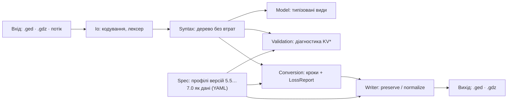

# ТЗ: PHP-бібліотека GEDCOM (Korin)

Nov 14, 2026 · @Serhii

## 1. Мета і межі

Korin — відкрита PHP-бібліотека, яка читає, перевіряє, конвертує і записує GEDCOM від 4.0 до 7.0.x без втрати даних. Кожну втрату, якої не уникнути при переході на стару версію, вона явно фіксує у звіті.

Бібліотека — фундамент архіву «Пам'ять про себе», але розробляється як самостійний продукт для будь-кого.

**Входить у v1.0:**

- читання GEDCOM 4.0, 5.0–5.4 (best effort), 5.5, 5.5.1, 5.5.5, 7.0.x і GEDZIP;
- запис 5.5, 5.5.1, 5.5.5, 7.0.x і GEDZIP;
- автоматичне визначення версії та кодування;
- конвертація між будь-якими двома версіями зі звітом про втрати;
- валідація за профілем конкретної версії;
- збереження невідомих і `_`-тегів;
- типізований доступ до записів (особи, сім'ї, джерела, медіа, дати, імена, місця);
- потоковий (`stream()`) та індексований (`open()`) режими для великих файлів;
- CLI-утиліта в окремому пакеті.

**Не входить у v1.0:** GEDCOM X (окремий пакет пізніше), відображення дерева, робота з API FamilySearch чи Ancestry, збереження в БД, злиття дублікатів осіб.

## 2. Назва, ліцензія, розміщення

Назва — **Korin** (від «корінь»): коротка, легко читається англійською і не містить торгової марки GEDCOM. Ліцензія — Apache-2.0.

| Що | Значення |
| --- | --- |
| Composer-пакет | `korin/gedcom` |
| Неймспейс | `Korin\Gedcom` |
| GitHub | `serjio-dev` (особистий акаунт): [serjio-dev/korin-php](https://github.com/serjio-dev/korin-php) |
| Репозиторії | `korin-php` (бібліотека), `korin-cli` (утиліта), `gedcom-corpus` (спільний тестовий корпус) |
| Реєстр | Packagist, автооновлення за git-тегами |
| Документація | GitHub Pages з теки `docs/` |

**Чому Apache-2.0.** Специфікація FamilySearch GEDCOM і її машинно-читані файли поширюються під Apache-2.0 ([FamilySearch](https://www.familysearch.org/help/helpcenter/article/what-is-the-familysearch-gedcom-7-0-standard)), тож їх можна включити в репозиторій без конфлікту ліцензій. Apache-2.0 дає патентний грант і сумісна з MIT- та GPLv3-проєктами.

**Торгова марка.** У README і на сайті: «GEDCOM is a trademark of Intellectual Reserve, Inc. Korin is not affiliated with or endorsed by FamilySearch.»

**Відкинуті назви:** Rodovid (зайнята генеалогічним сайтом rodovid.org), gedkit / gedcomkit (зайнята [Rust-бібліотекою](https://docs.rs/crate/gedcomkit/0.1.4)).

**Відкрите питання:** перед стартом зареєструвати vendor `korin` на Packagist; якщо зайнято — запасний варіант `serjio-dev/korin`.

## 3. Версії GEDCOM, кодування і діалекти

Повна підтримка — 5.5, 5.5.1, 5.5.5 і 7.0.x; старіші версії тільки читаються. На 14.11.2026 останній реліз — [7.0.18 від 17.02.2026](https://en.wikipedia.org/wiki/GEDCOM), 7.1 ще в робочій чернетці.

| Версія | Читання | Запис | Примітка |
| --- | --- | --- | --- |
| 7.1 (чернетка) | — | — | Відстежуємо в окремій гілці, додаємо після офіційного релізу |
| 7.0.0–7.0.18 (2021–2026) | ✓ | ✓ | Тільки UTF-8, `SCHMA` для розширень, GEDZIP (`.gdz`) |
| 5.5.5 (2019) | ✓ | ✓ | Уточнення 5.5.1 від спільноти gedcom.org |
| 5.5.1 (1999, повторно 2019) | ✓ | ✓ | Найпоширеніша; формат за замовчуванням для експорту «для сумісності» |
| 5.5 (1996) | ✓ | ✓ | Кодування лише ANSEL, ASCII, UNICODE (UTF-16) |
| 5.0–5.4 (чернетки) | best effort | — | Читаються профілем 5.5 у м'якому режимі |
| 4.0 | best effort | — | Старі експорти PAF; перетворення в 5.5 зі звітом |
| GEDCOM X | — | — | Інша модель (JSON/XML); окремий пакет `korin/gedcomx` після 1.0 |

**Кодування при читанні:** UTF-8 (з BOM і без), UTF-16 LE/BE, ASCII, ANSEL (з перестановкою комбінованих діакритиків), Windows-1250/1251/1252, CP437/CP850 (IBMPC), MacRoman. Windows-1251 нестандартне, але обов'язкове: так експортують чимало програм із кирилицею.

**Порядок визначення:** BOM → `HEAD.CHAR` → евристика за байтами. Якщо `CHAR` суперечить вмісту, перемагає вміст, а в діагностику пишеться попередження. Кодування можна задати явно.

**Кодування при запису:** 7.0 і 5.5.5 — UTF-8; 5.5.1 — UTF-8 (або ANSEL / UTF-16 за опцією); 5.5 — UTF-16 (або ANSEL). Символ, якого немає в цільовому кодуванні, дає запис у звіті про втрати, а не тиху заміну на `?`.

**BOM** (byte order mark, символ U+FEFF на початку файлу; у UTF-8 — байти `EF BB BF`) нічого не означає для даних, лише підказує іншим програмам кодування.

| Запис | BOM за замовчуванням | Чому |
| --- | --- | --- |
| 7.0 | Так | Специфікація 7.0: «The first character in each data stream should be U+FEFF» |
| 5.5.5 | Так | Вимога 5.5.5 (звірити з текстом специфікації при складанні профілю, етап 0.2) |
| 5.5.1, 5.5 у UTF-8 | Ні | Специфікації BOM не згадують, частина старих програм не розпізнає `0 HEAD` після BOM |
| UTF-16 будь-якої версії | Так | Без BOM порядок байтів доводиться вгадувати |

`WriteOptions::withBom(bool)` змінює поведінку; режим `preserve` лишає BOM таким, як був у джерелі.

**Діалекти програм.** Бібліотека визначає програму-джерело за `HEAD.SOUR` і застосовує задокументовані виправлення її відомих помилок. Цільовий перелік для корпусу: Ancestry, FamilySearch, MyHeritage, Family Tree Maker, RootsMagic, Legacy, PAF, Gramps, webtrees, Heredis, Family Historian, GeneWeb. Невідомі і `_`-теги (`_UID`, `_APID`, `_FSFTID`, `_FREL`, `_MREL` тощо) зберігаються завжди. Значення відомих тегів беруться з реєстру розширень, не зі здогадок.

## 4. Версії PHP і залежності

Мінімум — PHP 8.2, діапазон v1.x — 8.2–8.6. Підтримувати 8.0 і 8.1 не варто: вони вже не отримують навіть виправлень безпеки, у 8.0 немає enum, а readonly-класи з'явилися лише в 8.2.

| PHP | Безпекова підтримка до | Korin 1.x |
| --- | --- | --- |
| 8.6 | GA [19.11.2026](https://php.watch/versions/8.6/releases) | ✓ (у CI вже з RC) |
| 8.5 | 31.12.2029 | ✓ |
| 8.4 | 31.12.2028 | ✓ |
| 8.3 | 31.12.2027 | ✓ |
| 8.2 | 31.12.2026 | ✓ (мінімум) |
| 8.1 | 31.12.2025, EOL | — |
| 8.0 | 26.11.2023, EOL | — |

Дати — за [графіком підтримки PHP](https://endoflife.ai/article-php-eol.html).

**Правила сумісності:**

- Код пишеться синтаксисом 8.2. Rector і PHPStan налаштовані на `phpVersion: 80200` і блокують можливості 8.3+ (типізовані константи, хуки властивостей тощо).
- У CI застарілі функції (deprecations) на 8.5 і 8.6 вважаються помилками, нічна збірка PHP — інформативно.
- Мінімальна версія PHP піднімається лише в мінорному релізі (ніколи в патчі), з анонсом за один мінор до того. Після EOL 8.2 вона лишається до першого мінору, якому потрібен новіший синтаксис.
- 8.2 лишається мінімумом свідомо, попри EOL наприкінці 2026: бібліотека не залежить від розширень, а ширший діапазон дає більше користувачів. Ціна — тестовий код, сумісний з PHPUnit 11–13: тільки атрибути (`#[Test]`, `#[DataProvider]`), без docblock-анотацій, обережно з API моків.

**Залежності під час роботи — нуль.** Таблиці кодувань (ANSEL, CP125x, CP437/850, MacRoman) написані на чистому PHP, тож обов'язкових розширень немає.

- `ext-mbstring` / `ext-iconv` — опційно, пришвидшують UTF-16 і CP125x;
- `ext-zip` — у `suggest`, потрібен лише для GEDZIP.

**Dev-залежності:** PHPUnit `^11.5 || ^12.5 || ^13`. Composer сам вибирає версію під PHP: [11 працює з 8.2, 12 — з 8.3, 13 — з 8.4](https://phpunit.de/supported-versions.html). Також PHPStan 2.x, PHP-CS-Fixer, Rector, Infection, PHPBench і `nikic/php-fuzzer`.

## 5. Архітектура

Ядро бібліотеки — безвтратне дерево вузлів, яке пам'ятає оригінальні рядки. Усе інше — типізовані представлення, валідація, конвертація і запис — працює поверх нього. Правила кожної версії GEDCOM задані даними, а не кодом.



Файл декодується в одне дерево; модель, валідація і конвертація читають його, а правила версій приходять зі Spec.

| Шар | Неймспейс | Відповідальність |
| --- | --- | --- |
| Ввід | `Korin\Gedcom\Io` | Джерела (файл, потік, рядок), визначення і декодування кодування, лексер рядків (рівень, xref, тег, значення, номер рядка) |
| Синтаксис | `Korin\Gedcom\Syntax` | Дерево `Document` → `Record` → `Structure`; склейка `CONC`/`CONT`, екранування `@`, оригінальні байти і кінці рядків |
| Специфікації | `Korin\Gedcom\Spec` | Профілі версій: структури, кардинальність, типи значень, переліки, календарі. 7.0 — з машинно-читаних файлів FamilySearch; 5.x — наші YAML у тому ж форматі |
| Модель | `Korin\Gedcom\Model` | Типізовані представлення поверх дерева (`Individual`, `Family`, `Source`, `Repository`, `Media`, `SharedNote`, `Submitter`) і value-об'єкти (`GedcomDate`, `Age`, `PersonalName`, `Place`, `Coordinates`, `Language`, `MediaType`, `Xref`) |
| Валідація | `Korin\Gedcom\Validation` | Перевірка документа за профілем, `Diagnostic` зі стабільним кодом |
| Конвертація | `Korin\Gedcom\Conversion` | Кроки між сусідніми версіями, `LossReport` |
| Запис | `Korin\Gedcom\Writer` | Серіалізація під версію: довжина рядка, `CONC`/`CONT`, кодування, кінці рядків, детермінований порядок |
| Контейнер | `Korin\Gedcom\Gedzip` | Читання і запис `.gdz` з медіа |
| Розширення | `Korin\Gedcom\Extension` | Реєстр відомих `_`-тегів і URI з `SCHMA`, детектори діалектів програм |

**Принципи:**

- **Два режими запису.** `preserve` віддає незмінені вузли байт у байт; `normalize` перезбирає файл за канонічними правилами версії.
- **Представлення, а не копії.** `Individual` читає з дерева і пише в нього; невідомі теги не губляться, бо дані ніколи не копіюються в окрему модель.
- **Незмінні value-об'єкти.** `GedcomDate`, `PersonalName`, `Place` та інші value-об'єкти — `final readonly`. Представлення (`Individual`, `Family`, …) — `final`, але не `readonly`: вони «живі».
- **Компактне дерево.** Вузли зберігаються не як окремі PHP-об'єкти, а в упакованих масивах (рівень, тег, значення, зсуви в сирий буфер); об'єкти-вузли створюються ліниво при зверненні. Без цього ціль «50 МБ → ≤ 512 МБ» недосяжна.

**Модель змін (варіант «змінне дерево»):**

- `Document` змінний; редагування — методами дерева і представлень (`setValue`, `append`, `remove`, `renameXref`).
- **Функції не змінюють свій вхід.** `Gedcom::convert()`, `Validator`, `Writer` працюють з копією або лише читають; змінює документ тільки код викликача.
- `$doc->copy()` — дешевий знімок (copy-on-write масивів PHP).
- **Стабільні ID вузлів.** Вузол адресується ID, а не позицією серед сусідів; видалення лишає «надгробок», масиви не зсуваються. Тому вставка сусіда не зсуває вже отримані представлення.
- **Живі представлення.** `Individual` і підструктури бачать зміни, зроблені будь-де; звернення до видаленого вузла кидає `DetachedNodeException`.
- **Індекси** (xref → запис, зворотні зв'язки `FAMS`/`FAMC`) оновлюються методами редагування, а не перебудовуються.
- **Прапорець dirty.** Зміна вузла позначає його і предків; `preserve` пише незмінені вузли з оригінальних байтів.
- Undo / історія змін, якщо знадобляться, будуються пізніше поверх цієї моделі як журнал операцій.
- **Розширюваність.** Нова версія GEDCOM = новий профіль + кроки конвертації до сусіда, без змін у ядрі.
- **Приватне позначається явно.** Усе, що не позначене `@internal`, є публічним API і підпадає під гарантії SemVer.

**Окремі пакети:** `korin/gedcom-cli` (команди `info`, `validate`, `convert`, `diff`), пізніше — `korin/gedcom-bundle` для Symfony і `korin/gedcomx`.

## 6. Публічний API

Точка входу — фасад `Gedcom` із статичними методами для типових задач. За ним стоять звичайні класи (`Reader`, `Writer`, `Converter`, `Validator`), які можна ін'єктувати в DI-контейнер.

```php
use Korin\Gedcom\Gedcom;
use Korin\Gedcom\Version;

// Читання: версія і кодування визначаються автоматично
$doc = Gedcom::read('family.ged');
$doc->version();   // Version::V5_5_1
$doc->encoding();  // Encoding::Windows1251

foreach ($doc->individuals() as $person) {
    echo $person->name()?->full(), ' — ', $person->birth()?->date()?->toString(), PHP_EOL;
}

// Валідація
$report = Gedcom::validate($doc);
foreach ($report->errors() as $d) {
    printf("%s line %d: %s\n", $d->code, $d->line, $d->message);
}

// Конвертація зі звітом про втрати
$result = Gedcom::convert($doc, Version::V7_0);
Gedcom::write($result->document(), 'family-7.ged');
$result->losses();  // LossReport (порожній при підвищенні версії)

// Великі файли: по одному запису, пам'ять не залежить від розміру
foreach (Gedcom::stream('huge.ged') as $record) {   // Syntax\Record, без втрат
    $person = $record->view();                      // модель лише в межах запису
    $person->familyXrefs();                         // ['@F1@'], а families() кидає RequiresDocumentException
}

// Великі файли з повною моделлю: індекс xref → зсув, записи читаються з диска на вимогу
$doc = Gedcom::open('huge.ged');                    // лише читання
$doc->individual('@I1@')?->families();              // працює, бо сусідні записи підтягуються з файлу

// Створення з нуля: xref генерується детерміновано
$doc  = Document::create(Version::V7_0);
$anna = $doc->addIndividual()
    ->setName(PersonalName::of('Анна', 'Коваль'))
    ->setSex(Sex::Female)
    ->addBirth(GedcomDate::parse('12 MAR 1921'), Place::of('Полтава, Україна'));
$doc->addFamily()->setWife($anna)->addChild($ivan);  // FAMS/FAMC проставляються автоматично

// Редагування існуючого: представлення «живі», зміни одразу в дереві
$doc->individual('@I1@')->editName(fn (PersonalName $n) => $n->withSurname('Ковальова'));
$doc->removeRecord('@S12@');  // діагностика, якщо на запис ще є посилання

Gedcom::write($doc, 'out.ged', WriteOptions::preserve());  // змінене — за правилами версії, решта — байт у байт

// GEDZIP
$archive = Gedcom::readGedzip('family.gdz');
$archive->document();
$archive->media('photos/anna.jpg');  // потік, без розпакування на диск
```

**Режими читання:**

| Режим | Пам'ять | Що доступно |
| --- | --- | --- |
| `Gedcom::read()` | Усе дерево | Повна модель, редагування, валідація всіх рівнів |
| `Gedcom::stream()` | Постійна | `Syntax\Record` з оригінальними байтами; `view()` — модель у межах запису; методи, яким потрібні інші записи, кидають `RequiresDocumentException`. Валідація рівнів 1–4 |
| `Gedcom::open()` | Індекс: xref → зсув у файлі, ~50 байт на запис, + LRU-кеш розібраних записів | Повна модель лише для читання; валідація всіх рівнів. Для редагування — `$doc->load()` повертає документ як після `read()`. Потрібне джерело, яке можна читати з довільного місця; інакше вхід спершу копіюється в `php://temp` |

`stream()`, а потім запис кожного `Record` у `preserve` дає вхідний файл байт у байт. Кодування в потоці визначається за BOM, `HEAD.CHAR` і евристикою на перших 64 КБ; суперечність далі у файлі дає діагностику без перекодування.

**Опції** (незмінні об'єкти з `with*()`-методами):

| Клас | Головне |
| --- | --- |
| `ReadOptions` | `strict` / `lenient`, явне кодування, явна версія, ліміти (глибина, довжина рядка, розмір) |
| `WriteOptions` | `preserve` / `normalize`, кодування, кінець рядка, максимальна довжина рядка |
| `ConvertOptions` | Політика втрат: `preserveAsExtension` (за замовчуванням), `dropWithReport`, `fail` |

**Помилки.** Усі винятки реалізують `Korin\Gedcom\Exception\GedcomException`. У м'якому режимі синтаксичні помилки стають діагностикою, а не винятком; у суворому — `ParseException` з номером рядка.

## 7. Конвертація між версіями

Конвертація йде ланцюжком сусідніх версій: 4.0 → 5.5 → 5.5.1 ↔ 7.0, а 5.5.5 під'єднано до 5.5.1. Так для N версій потрібно лише N−1 пар кроків, і кожен крок тестується окремо. Будь-яка пара, наприклад 7.0 → 5.5, складається з кроків ланцюжка.

**Гарантії:**

- підвищення версії безвтратне: те, для чого в новій версії немає структури, лишається розширенням, описаним у `SCHMA`;
- пониження версії за замовчуванням не викидає дані: несумісне стає `_`-тегом і записом у `LossReport`;
- детермінованість: той самий вхід дає той самий вихід байт у байт;
- ідемпотентність: повторна конвертація в ту саму версію нічого не змінює;
- цикл вгору-вниз-вгору (7.0 → 5.5.1 → 7.0) відновлює семантично той самий документ;
- потокова конвертація (`convertFile()`) дає байт у байт той самий результат і `LossReport`, що й `read()` + `convert()` + `write()`.

**Ключові правила 5.5.1 ↔ 7.0.** Повний перелік — за офіційним [гайдом міграції](https://gedcom.io/specifications/FamilySearchGEDCOMv7.html); кожне правило — окремий клас із власним тестом.

| 5.5.1 | → 7.0 | ← назад у 5.5.1 |
| --- | --- | --- |
| `CHAR`, будь-яке кодування | Тільки UTF-8, `CHAR` прибирається | `CHAR UTF-8` |
| `CONC` | Склеюється в один рядок | Розбивається за лімітом довжини |
| `@@` у тексті | Подвоєння лише початкового `@` | Назад до правил 5.5.1 |
| Запис `NOTE` | `SNOTE` | `NOTE` |
| `SUBN` | Прибирається, значення — у `_SUBN` | Відновлюється з `_SUBN` |
| `_UID` | `UID` | `_UID` |
| `AFN`, `RFN`, `RIN` | `EXID` з `TYPE` | Назад у вихідний тег, інакше `REFN` + `TYPE` |
| `FORM` медіа (`jpg`) | MIME (`image/jpeg`), `FILE` як URI | Назад у розширення файлу |
| `LANG` словом (`Ukrainian`) | BCP 47 (`uk`) | Назад у назву мови |
| `ASSO` + `RELA` | `ASSO` + `ROLE` (+ `PHRASE`) | `RELA` |
| Дата `INT … (…)`, подвійний рік `1700/01` | `DATE` + `PHRASE` | Текстова дата 5.5.1 |
| Вбудовані `OBJE` / `SOUR` / `NOTE` без посилання | Виносяться в записи або стають `NOTE` | Лишаються записами |
| Xref з малими літерами, пробілами тощо (`@NoTe ref@`) | Валідний у 7.0 xref лишається; інший стає `@X<n>@` (наступний вільний `n` у порядку документа) | Лишаються як є |
| Посилання на неіснуючий запис (з урахуванням регістру: `@test@` ≠ `@TEST@`) | `@VOID@` + запис у діагностиці | — |
| — | Структура з `@VOID@` | Стає `_`-тегом з підструктурами, запис у `LossReport` |
| — | `NO`, `SDATE`, `CREA`, `INIL`, `TRAN`, `CROP`, `SEX X` | `_NO`, `_SDATE`, `_CREA`, `_INIL`, `_TRAN`, `_CROP`, `SEX U` + `_SEX X` |

**Інші кроки:** 5.5 ↔ 5.5.1 (зокрема `EMAIL`, `FAX`, `WWW`, `MAP`/`LATI`/`LONG`, що з'явилися в 5.5.1); 5.5.5 ↔ 5.5.1 (суворіші правила 5.5.5 застосовуються при запису); 4.0 / 5.0–5.4 → 5.5 (best effort).

**Домовленості виходу конвертації** (від них залежать еталонні файли корпусу; зміна будь-якої — зміна очікуваних результатів):

- **BOM** — за правилами цільової версії з розділу 3 (для 7.0 — є).
- **Кінці рядків** — як у джерелі; якщо в джерелі змішані — переважний (найчастіший); `WriteOptions` може задати явно.
- **`HEAD.SOUR`** переноситься з джерела без змін: це програма, яка створила дані, а не конвертер. Korin себе в `HEAD` не дописує.
- **`HEAD.DATE`** не оновлюється, щоб вихід був детермінованим.
- **Службові структури джерела**, яких немає в цільовій версії і які описують сам файл (`CHAR`, `GEDC.FORM` при переході на 7.0), прибираються без запису в `LossReport`: вони не є даними.
- **Порядок** записів і підструктур — як у джерелі; винесені й нові записи йдуть перед `TRLR` у порядку появи.
- **Нові xref** — `@X<n>@`, наступний вільний `n` у порядку документа.

**`LossReport`** — список записів з полями: стабільний код (`KL2001`), серйозність, шлях у дереві (`@I1@/BIRT[0]/DATE`, формат шляхів — як у корпусі), рядок джерела, як збережено (`extension` / `note` / `dropped`), повідомлення. Експортується в JSON.

### Потокова конвертація

`Gedcom::convertFile($in, $out, Version::V7_0)` конвертує файл будь-якого розміру з постійною пам'яттю: вхід читається по одному запису, вихід пишеться одразу.

Деякі кроки не можуть писати вихід, поки не побачать увесь вхід, бо їхній результат потрапляє на початок файлу або залежить від записів, що йдуть далі:

| Що потребує всього файлу | Чому | Напрям |
| --- | --- | --- |
| Перейменування xref і `@VOID@` | Посилання може стояти до визначення запису; нова назва не повинна зіткнутися з xref далі у файлі | 5.5.1 → 7.0 |
| `HEAD.SCHMA` | Розширення може вперше трапитися в останньому записі, а `SCHMA` стоїть у `HEAD` | 5.5.1 → 7.0 |
| `SUBN` → `HEAD._SUBN` | Запис `SUBN` може стояти будь-де | 5.5.1 → 7.0 |
| xref для винесених `OBJE` / `SOUR` | Потрібна множина всіх зайнятих xref | 5.5.1 → 7.0 |
| Кодування | Евристика на початку файлу може помилитися (CP1251 / CP1252 на латиниці однакові) | Будь-який з 8-бітного кодування |

**Два проходи.**

1. **Попередній прохід** — тільки лексер, без дерева (орієнтовно третина часу повного читання). Збирає множину xref і зсуви записів, теги розширень, зсув `SUBN`, кодування за всім файлом. Це та сама інформація, що й індекс `open()`, тож `convertFile()` побудований на `open()` + послідовному обході, а не окремим кодом.
2. **Основний прохід** — записи по одному: кроки конвертації, запис. Нові записи (винесені `OBJE` / `SOUR`) накопичуються і пишуться перед `TRLR`.

**Попередній прохід лише за потреби.** Кожен крок оголошує `needsPrepass()`; ланцюжок робить попередній прохід, лише якщо цього потребує хоч один крок. 7.0 → 5.5.1, 5.5 ↔ 5.5.1 ↔ 5.5.5 — однопрохідні.

**Входи, які не можна прочитати двічі:**

| Вхід | Поведінка |
| --- | --- |
| Файл | Читається двічі, без копій |
| Запис у `.gdz` | Відкривається вдруге через `zip://` (повторне розпакування в пам'яті, без диска) |
| `stdin`, pipe, мережевий потік | Якщо потрібен попередній прохід — копія в `php://temp` (до 2 МБ у пам'яті, далі тимчасовий файл); інакше — без копії |

**Пам'ять:** множина xref (~70 байт на запис; ~15 МБ для 200 тис. записів) + один запис + накопичені нові записи.

**Відкинута альтернатива:** один прохід входу з тілом у тимчасовий файл і `HEAD`, дописаним наприкінці. Вона вирішує `SCHMA` і `SUBN`, але не xref: посилання вже записане до того, як відомо, на що його замінити, — тож потрібен другий прохід по виходу.

## 8. Валідація

Валідатор перевіряє документ за профілем його версії на п'ятьох рівнях і повертає діагностику зі стабільними кодами. Файл із помилками все одно читається: вирішує викликач.

| Рівень | Що перевіряє | Коди |
| --- | --- | --- |
| Синтаксис | Формат рядка, стрибки рівнів, xref, довжина рядка, кодування, `HEAD`/`TRLR` | `KV1xxx` |
| Структура | Допустимі підструктури і кардинальність за профілем, обов'язкові теги | `KV2xxx` |
| Значення | Дати і календарі, вік, переліки, MIME, мови, координати, тип цілі посилання | `KV3xxx` |
| Посилання | Висячі xref, дублікати xref, узгодженість `FAMS`/`FAMC` з `HUSB`/`WIFE`/`CHIL` | `KV4xxx` |
| Правдоподібність (опційно) | Народження після смерті, цикл у родоводі, дитина старша за батька — лише попередження | `KV5xxx` |

- Серйозність: `error`, `warning`, `info`; кожен код можна вимкнути або підвищити.
- Кожна діагностика має рядок, шлях у дереві та посилання на розділ специфікації.
- Формати звіту: об'єкти PHP, JSON, текст для CLI.
- Усі коди задокументовані в `docs/diagnostics.md` і не змінюють значення в межах мажорної версії.

Контроль якості валідатора: його висновки для 7.0 звіряються з очікуваними результатами офіційних тестових файлів і з відкритими валідаторами зі [списку gedcom.io](https://gedcom.io/tools/).

## 9. Безпека і продуктивність

Будь-який вхідний файл вважається ворожим: бібліотека ніколи не падає некеровано, не виходить за задані ліміти і не звертається до мережі.

**Захист:**

- Ліміти за замовчуванням (змінюються в `ReadOptions`): глибина вкладеності, довжина рядка, кількість записів, розмір файлу.
- GEDZIP: захист від zip-slip (нормалізація шляхів, заборона `..` і абсолютних шляхів), від zip-бомб (ліміт стиснення і сумарного розміру), симлінки ігноруються.
- URI з `FILE` ніколи не завантажуються і не відкриваються автоматично.
- Жодних `eval`, `unserialize`, динамічних include; регулярні вирази — з лінійною складністю (перевірка на ReDoS у тестах).
- Винятки не містять вмісту файлу більше за фрагмент рядка: у деревах є персональні дані, а винятки потрапляють у логи.
- `SECURITY.md` і приватні звіти про вразливості через GitHub Security Advisories.

**Цільові показники** (перевіряються PHPBench на еталонній машині CI, PHP 8.5, одне ядро):

| Сценарій | Ціль |
| --- | --- |
| Потокове читання | Пам'ять не зростає з розміром файлу (орієнтир ≤ 32 МБ) |
| Повне читання файлу 50 МБ | ≤ 512 МБ пам'яті, ≤ 20 с |
| `open()` файлу 50 МБ | Індекс ≤ 64 МБ пам'яті, побудова ≤ 5 с; доступ до запису поза кешем ≤ 1 мс |
| Конвертація 5.5.1 → 7.0 файлу 50 МБ | ≤ 2× часу повного читання |
| `convertFile()` 5.5.1 → 7.0 файлу 50 МБ | ≤ 64 МБ пам'яті, ≤ 1,5× часу повного читання |
| Регресія в PR | Більше 10% — PR блокується |

Цілі попередні: фіксуємо їх після перших замірів на корпусі (етап 0.1).

## 10. Тестування

Кожен файл корпусу проходить усю матрицю: читання, запис у ту саму версію і конвертацію в кожну версію запису, від найнижчої до найвищої і навпаки. Результат кожної конвертації має пройти валідатор цільової версії без помилок.

**Матриця конвертацій** (у клітинці — скільки кроків ланцюжка проходить тест):

| Джерело ↓ / ціль → | 5.5 | 5.5.1 | 5.5.5 | 7.0 |
| --- | --- | --- | --- | --- |
| 7.0 | 2 | 1 | 2 | round-trip |
| 5.5.5 | 2 | 1 | round-trip | 2 |
| 5.5.1 | 1 | round-trip | 1 | 1 |
| 5.5 | round-trip | 1 | 2 | 2 |
| 5.0–5.4 | 1 | 2 | 3 | 3 |
| 4.0 | 1 | 2 | 3 | 3 |

**Види тестів:**

1. **Модульні** — на кожен клас, зокрема на кожне правило конвертації і кожну таблицю кодування.
2. **Відповідність специфікації** — генеруються з профілів: для кожної структури перевіряється допустиме і недопустиме розміщення, кардинальність, тип значення.
3. **Round-trip** — у режимі `preserve` вихід байт у байт дорівнює входу; у `normalize` — семантично рівний.
4. **Матриця конвертацій** — для кожної клітинки вище: вихід валідний для цільової версії, `LossReport` збігається з еталонним (golden) файлом.
   Кожна клітинка проганяється двічі: `read()` + `convert()` + `write()` і `convertFile()`; виходи й `LossReport` мають збігатися байт у байт (перевірка `convert-stream` у корпусі).
5. **Інваріанти вгору-вниз-вгору** — «отисок» документа (канонічний JSON семантичного вмісту) після 7.0 → 5.5 → 7.0 дорівнює вихідному, крім пунктів із `LossReport`.
6. **Генеративні (property-based)** — випадкові валідні документи за граматикою профілю проходять ланцюжок конвертацій з тими ж інваріантами.
7. **Кодування** — кожна кодова сторінка, комбіновані діакритики ANSEL, BOM, невідповідність `CHAR` і вмісту, кирилиця в CP1251 і UTF-16.
8. **Фазинг** — `nikic/php-fuzzer` на лексер, декодери, дати і GEDZIP: без незадокументованих винятків і виходу за ліміти.
9. **Мутаційні** — Infection перевіряє, що тести справді ловлять помилки, а не лише проходять код.
10. **Бенчмарки** — PHPBench, цілі з розділу 9.

**Пороги якості:** покриття рядків ≥ 95%, гілок ≥ 90% для `Io`, `Syntax`, `Conversion`, `Writer`; MSI (Infection) ≥ 85%.

**Корпус** — окремий репозиторій `gedcom-corpus`, підключений як dev-залежність:

| Джерело | Ліцензія | Як використовуємо |
| --- | --- | --- |
| `gedcom7code/test-files` | Unlicense | Вбудовано в корпус |
| Приклади з [gedcom.io](https://gedcom.io/) і машинно-читані файли специфікації | Apache-2.0 | Вбудовано з текстом ліцензії |
| Torture-тести GEDCOM 5.5 (H. Eichmann) | Уточнити | Завантажуються скриптом під час тестів, у репозиторій не кладемо |
| Власні експорти з програм розділу 3 | Apache-2.0 | Створюємо тестове дерево з вигаданих людей в кожній програмі та експортуємо |

Реальні дерева живих людей у корпус не потрапляють.

**Репозиторій `gedcom-corpus` створюється з першого дня** і містить лише дані, без коду бібліотеки. Профілі версій і правила конвертації потрібні Korin під час роботи, тому лишаються в `korin-php` (у YAML).

- **Структура:** `cases/<назва>/` з `input.ged` (або `.gdz`), `expected.<версія>.ged`, `losses.<версія>.json`, `fingerprint.json` і `case.yaml` (джерело, ліцензія, що перевіряє кейс). Формат JSON-файлів описаний JSON Schema в `schema/`.
- **Кейси редагування:** `ops.json` — мовно-незалежний список операцій над `input.ged` (`setValue`, `addChild`, `remove`, `renameXref`, `addRecord`, `removeRecord`) з адресацією шляхами, і `expected.ged` — результат після них. Так сценарії з розділу 6 перевіряються однаково в будь-якій мові.
- **`fingerprint.json`** — канонічний JSON семантики: записи й підструктури в порядку документа, значення в Unicode NFC після склейки `CONC`/`CONT` і зняття `@@`, без змінних полів `HEAD` (`DATE`, `SOUR`, `CHAR`, `GEDC`). Порівнюється лише в межах однієї версії GEDCOM.
- **`.gitattributes`** у обох репозиторіях: `*.ged` і `*.gdz` — `binary`, щоб Git на Windows не чіпав кінці рядків.
- **Ліцензії:** кожна тека-джерело має власний `LICENSE`; файли з неясною ліцензією не кладуться, а завантажуються скриптом `fetch-external`.
- **Версіонування:** власні SemVer-теги. Новий кейс — мінор; зміна очікуваного результату існуючого кейсу — мажор.
- **Підключення до Korin:** Composer-пакет `korin/gedcom-corpus` у `require-dev` з фіксованим діапазоном версій. Інші мови беруть його через git submodule або архів GitHub Release.
- **Робочий процес:** зміна поведінки Korin, що зачіпає очікувані результати, спершу мерджиться в корпус і отримує тег, потім PR у `korin-php` піднімає версію корпусу. У корпусі власний CI: валідація JSON за схемами, перевірка наявності `case.yaml` і ліцензії, пошук персональних даних.

## 11. Якість коду і CI

Кожен PR проходить тести на PHP 8.2–8.6, на трьох ОС і з мінімальними та максимальними версіями залежностей. Злиття в `main` можливе лише при зелених перевірках.

**Інструменти:**

- PHPStan 2.x, рівень `max` + `phpstan-strict-rules`, нуль винятків у baseline;
- PHP-CS-Fixer з набором PER Coding Style;
- Rector — тільки в режимі перевірки (`--dry-run`) з рівнем PHP 8.2;
- `composer-require-checker` і `composer-unused` — жодних прихованих залежностей;
- `declare(strict_types=1)` у кожному файлі, усі класи `final`, якщо не спроєктовані для розширення.

**Робочі процеси GitHub Actions:**

| Workflow | Коли | Що робить |
| --- | --- | --- |
| `tests` | Кожен push і PR | PHP 8.2, 8.3, 8.4, 8.5, 8.6 × `lowest`/`highest` на Ubuntu; Windows і macOS — на 8.2 та 8.6; покриття → Codecov |
| `php-nightly` | Щоночі | Нічна збірка PHP, падіння не блокує |
| `static` | Кожен PR | PHPStan, PHP-CS-Fixer, Rector, composer-перевірки |
| `mutation` | PR (змінені файли) + щотижня (усе) | Infection, поріг MSI |
| `fuzz` | Щоночі | Фазинг, знайдені входи додаються в корпус |
| `bench` | PR | Порівняння з `main`, блок при регресії > 10% |
| `release` | Тег `v*` | Збірка релізу, нотатки з CHANGELOG, атестація артефактів |

**Репозиторій:** захищена гілка `main`, обов'язкове рев'ю, підписані теги, Dependabot для Composer і Actions, OpenSSF Scorecard.

## 12. Версіонування і релізи

Бібліотека дотримується SemVer 2.0: злам сумісності публічного API — лише в мажорній версії. Реліз = підписаний git-тег `vX.Y.Z`, Packagist підхоплює його через webhook.

- **0.x** — до виконання критеріїв приймання (розділ 14); мінор може ламати API, зміни описуються в `UPGRADE.md`.
- **Гілки:** `main` — наступний мінор; `1.x`, `2.x` — гілки підтримки.
- **Підтримка:** останній мажор — нові можливості; попередній — виправлення безпеки ще 12 місяців.
- **Застаріле API** позначається `@deprecated` і `E_USER_DEPRECATED` щонайменше за один мінор до видалення.
- **Версія специфікації.** Новий патч GEDCOM 7.0.x дає мінорний реліз Korin, нова мінорна версія GEDCOM (7.1) — теж мінорний, бо це додавання профілю.
- **Процес:** Conventional Commits → `CHANGELOG.md` у форматі Keep a Changelog → тег → GitHub Release.

**Підключення в «Пам'ять про себе» чи будь-який інший проєкт:**

```bash
composer require korin/gedcom:^1.0
```

Оновлення — через Renovate або Dependabot. Поза релізами можна взяти конкретну гілку з GitHub (`dev-main` чи `1.x-dev`) або локальну копію через `path`-репозиторій Composer.

## 13. README і документація

README англійською, з робочим прикладом у перших 30 рядках; повна документація — на сайті в GitHub Pages, український переклад — після 1.0. Приклади коду в README та документації запускаються в CI, щоб не застарівали.

**Структура README:**

```markdown
# Korin — lossless GEDCOM for PHP

[CI] [Coverage] [Packagist] [PHP 8.2–8.6] [License: Apache-2.0]

Read, validate, convert and write GEDCOM 5.5, 5.5.1, 5.5.5 and 7.0 —
without losing a single tag. Every unavoidable loss is reported.

## Why Korin
## Supported versions (GEDCOM, encodings, PHP)
## Installation
## Quick start
   - Read a file
   - Iterate people and families
   - Convert 5.5.1 → 7.0 and back
   - Write
   - Validate
## Large files (streaming)
## GEDZIP
## Encodings and vendor dialects
## Conversion rules and the loss report
## Diagnostics reference
## CLI
## Performance
## Security
## Versioning and BC policy
## Contributing
## License and trademarks
## Acknowledgements
```

**Файли в корені репозиторію:** `README.md`, `LICENSE`, `NOTICE` (атрибуція специфікації FamilySearch), `CHANGELOG.md`, `UPGRADE.md`, `CONTRIBUTING.md`, `CODE_OF_CONDUCT.md` (Contributor Covenant), `SECURITY.md`, `CITATION.cff`, шаблони issue і PR.

**Сайт документації** (`docs/`): посібники за задачами, правила конвертації для кожної пари версій, довідник кодів `KV*` і `KL*`, таблиця діалектів програм, згенерована довідка API (phpDocumentor).

## 14. Етапи і критерії приймання

Робота йде шістьма етапами; кожен закінчується релізом 0.x на Packagist, щоб «Пам'ять про себе» могла підключати бібліотеку задовго до 1.0.

1. **0.1 — фундамент.** Каркас репозиторію і CI, корпус, `Io` + `Syntax` + `Writer` для 5.5.1 і 7.0, безвтратний round-trip, кодування UTF-8/UTF-16/ANSEL/CP1251/CP1252. Заміри продуктивності і порівняльний прогін корпусу через `liberu-genealogy/php-gedcom` для базової планки.
2. **0.2 — профілі і валідація.** Профілі 5.5, 5.5.1, 5.5.5, 7.0; валідатор рівнів 1–4; тести відповідності специфікації.
3. **0.3 — конвертація.** Кроки 5.5.1 ↔ 7.0, 5.5 ↔ 5.5.1, 5.5.5 ↔ 5.5.1; `LossReport`; повна матриця з розділу 10.
4. **0.4 — модель і медіа.** Типізовані представлення, дати з календарями, вік, імена, місця; GEDZIP; потоковий та індексований (`open()`) режими.
5. **0.5 — старі версії і інструменти.** Читання 4.0 і 5.0–5.4, діалекти програм, CLI, сайт документації, фазинг.
6. **1.0 — стабільний реліз** після виконання всіх критеріїв нижче.

Після 1.0: GEDCOM 7.1 після офіційного релізу, `korin/gedcomx`, Symfony-бандл.

**Критерії приймання 1.0:**

- [ ] Усі офіційні тестові файли GEDCOM 7 читаються і дають очікуваний результат валідації
- [ ] Round-trip у режимі `preserve` байт у байт для всього корпусу
- [ ] Уся матриця конвертацій зелена: вихід валідний, `LossReport` збігається з еталоном
- [ ] Інваріанти вгору-вниз-вгору виконуються для корпусу і генеративних тестів
- [ ] Покриття рядків ≥ 95%, гілок ≥ 90%, MSI ≥ 85%
- [ ] PHPStan `max` без помилок; CI зелений на PHP 8.2–8.6 і трьох ОС
- [ ] 24 години фазингу без нових збоїв
- [ ] Цілі продуктивності з розділу 9 досягнуті
- [ ] README, сайт документації і довідка API опубліковані
- [ ] Підписаний тег `v1.0.0`, пакет на Packagist

**Відкрите питання:** скільки часу на тиждень йде на бібліотеку — від цього залежать дати етапів.

## 15. Порти на інші мови

Зараз порти не робимо. У Python, JavaScript, Go і Rust вже є живі бібліотеки з підтримкою GEDCOM 7, а в PHP прогалина більша. Наш внесок для інших мов — спільний корпус і правила конвертації як дані.

| Мова | Що вже є | Висновок |
| --- | --- | --- |
| Rust (+ Python, JS/WASM) | [gedcomkit](https://docs.rs/crate/gedcomkit/0.1.1): збереження байтів, 5.5–7.x, GEDZIP, прив'язки для Python і Node.js | Найближчий за філософією аналог; варто звірятися з ним на корпусі |
| Python | [gedcom7](https://pypi.org/p/gedcom7) (ціль 7.0.18), gedcom-lite (5.5.1 і 7) | Для Python-сервісу проєкту вистачить готового; головна робота з GEDCOM усе одно в PHP |
| JavaScript / TypeScript | js-parser від gedcom7code, [gedcom-ts](https://app.unpkg.com/gedcom-ts@2026.6.4/files/README.md) | Порт знадобиться, лише якщо PWA матиме офлайн-імпорт у браузері |
| Go | iand/gedcom (5.5.1 і 7.0), [cacack/gedcom-go](https://pkg.go.dev/github.com/cacack/gedcom-go/gedcom) (5.5, 5.5.1, 7.0) | Попиту з боку проєкту немає |

Повний перелік інструментів — на [gedcom.io/tools](https://gedcom.io/tools/).

**Що робимо замість портів:**

- `gedcom-corpus` — незалежний від мови: вхідні файли, очікувані виходи, `losses.json`, `fingerprint.json`;
- профілі версій і правила конвертації у YAML, а не лише в PHP-коді — тоді порт на будь-яку мову перевикористовує їх і перевіряється на тих самих тестах.

**Коли повернутися до питання:** після 1.0 — якщо з'явиться попит ззовні (issues, зірки) або проєкту знадобиться імпорт у браузері. Перший кандидат — TypeScript.
